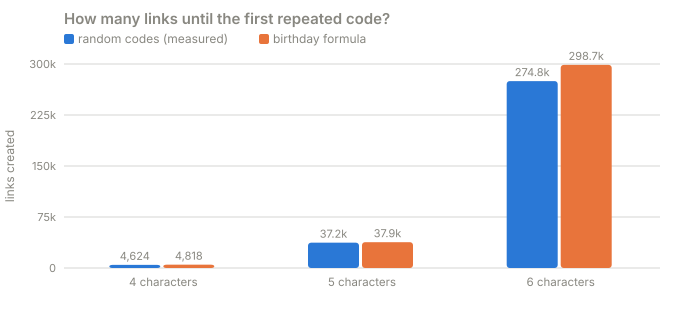
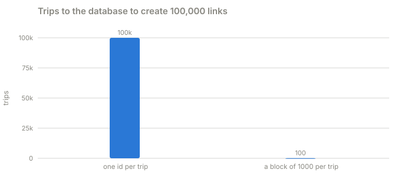

# Part 1 · The codes

**Question:** where does a short code like `Ab3dE9` come from, and how do you make sure two
links never get the same one?

**Answer:** don't pick codes, count. Give every link the next number from a counter, shuffle
the number so neighbours don't look alike, and write it in base 62. Numbers never repeat, so
codes never repeat. Picking codes at random starts colliding after about 275,000 links, and a
collision means an extra read, a retry, and a race between two replicas that picked the same one.

## Run it

From the repository folder. This part needs no Docker: it only runs the code-making half of
the service and counts.

```bash
uv run labs/lab-1-url-shortener/part-1-the-codes/the_codes.py            # a few seconds
uv run labs/lab-1-url-shortener/part-1-the-codes/the_codes.py --quick    # about a second
```

It prints five tables and saves them to [results.md](results.md).

## The idea, from zero

Think of a coat check. Two ways to hand out ticket numbers:

- **Pick a number at random.** Easy, and any desk can do it alone. But with a few hundred
  thousand coats on the racks, sooner or later you pick a number that is already on a coat.
  Now you have to check every time, and when two desks pick the same number at the same
  moment, one of them has to notice and start over.
- **Hand out the next number on a roll of tickets.** The roll can never hand out the same
  number twice, so there is nothing to check. Anyone can see the numbers are in order, though,
  and a roll shared by several desks has to be fetched from somewhere.

Our service uses the roll, and fixes its two problems:

1. **In order, so guessable.** Put the number through a shuffle that mixes it into something
   that looks random. A shuffle that can be undone never maps two numbers to the same value,
   so it keeps the "never repeats" promise.
2. **A shared roll is a trip to the database.** Each replica takes a whole *block* of 1,000
   numbers in one trip and hands them out from memory.

## What the part does, step by step

| Step | What happens | Code |
|---|---|---|
| 1 | Make random 4, 5 and 6 character codes until one repeats. Do it many times and take the median | [`first_collision`](the_codes.py#L32) |
| 2 | Work out when the first repeat should happen with the birthday formula, to check the measurement | [`theory_first_collision`](the_codes.py#L43) |
| 3 | Create 10,000 up to 1,000,000 links with random 6-character codes and count how often a code was already taken | [`random_collisions`](the_codes.py#L48) |
| 4 | Do the same with counter numbers put through the service's real shuffle, and count repeats | [`counter_collisions`](the_codes.py#L62) → [`encode`](../system/shortener/src/shortener/codes.py#L65) |
| 5 | Show the first five codes, and that each decodes back to its number | [`run`](the_codes.py#L87) → [`decode`](../system/shortener/src/shortener/codes.py#L72) |
| 6 | Create 100,000 links two ways: one id per trip to the counter, and a block of 1,000 per trip | [`round_trips`](the_codes.py#L68) → [`BlockAllocator`](../system/shortener/src/shortener/ids.py#L9) |
| 7 | Work out how long 6 characters last at 10, 100 and 1,000 new links a second | [`run`](the_codes.py#L87) |

### How the shuffle works

A number below 62^6 (56,800,235,584) is split into two halves of three base-62 digits each.
Four times over, the halves are swapped and one is mixed into the other with a cheap hash
([`shuffle`](../system/shortener/src/shortener/codes.py#L51)). This is a *Feistel network*.
Its trick is that the mixing hash never has to be undone: to run it backwards you subtract
the same hash instead
([`unshuffle`](../system/shortener/src/shortener/codes.py#L58)). That is why it can never
send two numbers to the same value.

It hides the counter from casual eyes. It is not encryption, so don't use it to keep secrets.

## The results

From the last full run on this laptop ([results.md](results.md)):



| code length | codes possible | links until first repeat (median) | the formula says |
|---|---|---|---|
| 4 | 14,776,336 | 4,624 | 4,818 |
| 5 | 916,132,832 | 37,205 | 37,935 |
| 6 | 56,800,235,584 | 274,789 | 298,700 |

| links created | random codes: retries | counter + shuffle: retries |
|---|---|---|
| 10,000 | 0 | 0 |
| 100,000 | 0 | 0 |
| 300,000 | 1 | 0 |
| 1,000,000 | 3 | 0 |

| counter value | code | decodes back to |
|---|---|---|
| 0 | tUwWP2 | 0 |
| 1 | IdZ23b | 1 |
| 2 | E4sFdy | 2 |
| 3 | fZzCX3 | 3 |
| 4 | f9wFUK | 4 |



### Where each number comes from

| Number | In plain words | Measured by | Code |
|---|---|---|---|
| links until first repeat | how many random codes you can make before one repeats | making codes until a repeat, 60 times, taking the median | [`first_collision`](the_codes.py#L32) |
| the formula says | the birthday formula: about `sqrt(pi x codes / 2)` | math, no measuring | [`theory_first_collision`](the_codes.py#L43) |
| random codes: retries | times a new code was already taken while creating that many links | counting repeats in a run of random codes | [`random_collisions`](the_codes.py#L48) |
| counter + shuffle: retries | the same, with the service's real counter and shuffle | making the codes and counting duplicates | [`counter_collisions`](the_codes.py#L62) |
| trips to the database | how often creating 100,000 links had to ask the shared counter for more ids | counting calls in the real allocator | [`round_trips`](the_codes.py#L68) |

## What it means

- **The birthday formula is accurate, and it is surprising.** Six characters allow 56.8
  billion codes, yet the first repeat arrives after about 275,000 links. That is the
  *birthday paradox*: you need far fewer people than days in the year before two share a
  birthday, because every new person can match any of the earlier ones.
- **At 275,000 links you need a plan for collisions anyway.** With random codes that means
  checking the database before or after every insert, and handling two replicas that pick
  the same code in the same millisecond. With a counter there is nothing to handle: the
  tables show zero repeats in a million links, and the test suite checks 300,000 more.
- **One id per trip is 1,000 times the database traffic.** Creating 100,000 links needs
  100,000 trips to the counter one at a time and 100 with blocks. A replica that crashes
  wastes the rest of its block. That leaves a gap in the numbers, and a gap harms nothing.
- **6 characters are plenty for most services, and not forever.** At 100 new links a second
  they last about 18 years. At 1,000 a second, about 2. After that the code simply grows
  to 7 characters ([`encode`](../system/shortener/src/shortener/codes.py#L65)): longer codes
  can never equal shorter ones.
- **Custom names live in the same space.** If someone picks the alias `tUwWP2`, the counter
  would hand out the same code later. The create path notices the taken code and takes the
  next number ([`_create_generated`](../system/shortener/src/shortener/api.py#L219)), and the
  API tests cover it.

Next: [part 2, the cache](../part-2-the-cache).
