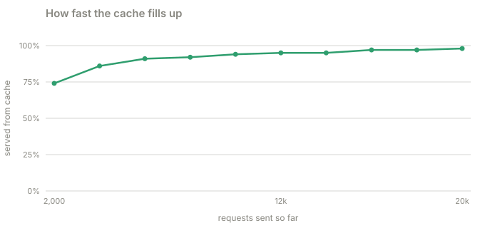

# Part 2 · The cache

**Question:** what does Redis buy the read path?

**Answer:** a cache hit skips the database. With nobody else waiting, a redirect takes 2.1 ms
from the cache and 3.3 ms through the database. Under load the gap opens up: 6 ms against
15 ms at the median, and 17 ms against 68 ms for the unlucky 1 in 100. Links in real life are
very uneven (a few get most of the clicks), so after 20,000 requests 98% of redirects never
touched the database.

## Run it

From the repository folder, with the stack running:

```bash
docker compose -f labs/lab-1-url-shortener/docker-compose.yml up -d --build     # once
uv run labs/lab-1-url-shortener/part-2-the-cache/the_cache.py            # about a minute
uv run labs/lab-1-url-shortener/part-2-the-cache/the_cache.py --quick    # about fifteen seconds
```

It prints its tables and saves them to [results.md](results.md). It makes its own links, so
it leaves your existing ones alone, but it does empty the *cache* (never the database) several
times to measure a cold start.

## The idea, from zero

Think of a library. Every question you ask the librarian means a walk to the stacks at the
back (the database): slow, but the books are always right. Now the librarian keeps the
twenty books people ask about most on the desk (the cache). Most questions are answered
without getting up.

Two things make this work for short links:

- **Reads vastly outnumber writes.** A link is made once and opened thousands of times.
- **Popularity is lopsided.** A few links (a launch announcement, a viral post) get most of
  the clicks. A small cache holding just those answers most requests.

Our cache is **cache-aside**: the API looks in Redis first; on a miss it reads Postgres, puts
the answer in Redis for an hour and returns it. Redis is *only* a shortcut, never the truth.

## What the part does, step by step

| Step | What happens | Code |
|---|---|---|
| 1 | Make 2,000 links through the real API, 16 at a time | [`create_links`](the_cache.py#L60) |
| 2 | Empty the cache, as if Redis had just restarted | [`flush_cache`](the_cache.py#L76) |
| 3 | **One at a time, cold:** open 800 links, one request at a time. Every one has to read the database | [`read_all(..., 1)`](the_cache.py#L161) |
| 4 | **One at a time, warm:** open the same 800 links again. Every one is now in the cache | [`read_all(..., 1)`](the_cache.py#L162) |
| 5 | **16 at a time, cold then warm:** the same two passes over all 2,000 links with 16 requests in flight, to see the effect on throughput | [`read_all`](the_cache.py#L166) |
| 6 | **Popular links:** empty the cache, then send 20,000 requests where link number k is picked with weight `1/(k+1)^1.1`, so a few links get most of the traffic | [`zipf_picks`](the_cache.py#L41), [`read_all`](the_cache.py#L172) |
| 7 | Cut that run into windows and work out the share served from the cache in each | [`hit_ratio_windows`](the_cache.py#L51) |
| 8 | Inside the API: ask the cache, on a miss ask the database and fill the cache | [`cache.get`](../system/shortener/src/shortener/api.py#L177), [`cache.set`](../system/shortener/src/shortener/api.py#L193) |
| 9 | Wait for the worker, then compare the clicks it counted with the redirects sent | [`wait_for_clicks`](the_cache.py#L102), [`counted_clicks`](the_cache.py#L114) |

Every request is sent by [sdl-load](../../../toolkit/sdl-load) and timed from the outside,
from just before it is sent to when the answer has fully arrived. The API tells us whether it
used the cache in an `X-Cache` header ([api.py](../system/shortener/src/shortener/api.py#L199)),
so each request is sorted by what actually happened, not by what we expected.

## The results

From the last full run on this laptop ([results.md](results.md)):


One request at a time, so there is no waiting in line:

| pass | requests | served from cache | p50 | p99 | req/s |
|---|---|---|---|---|---|
| cold: every link read once, cache empty | 800 | 0% | 3.3 ms | 5.7 ms | 277 |
| warm: the same links again | 800 | 100% | 2.1 ms | 4.4 ms | 420 |

With 16 requests in flight, like a busy moment:

| pass | requests | served from cache | p50 | p99 | req/s |
|---|---|---|---|---|---|
| cold: every link read once, cache empty | 2,000 | 0% | 7.2 ms | 27.1 ms | 1,558 |
| warm: the same links again | 2,000 | 100% | 6.0 ms | 13.1 ms | 2,454 |

Popular links, starting from an empty cache:



| requests sent so far | served from cache (this window) |
|---|---|
| 2,000 | 74% |
| 4,000 | 86% |
| 6,000 | 91% |
| 8,000 | 92% |
| 10,000 | 94% |
| 12,000 | 95% |
| 14,000 | 95% |
| 16,000 | 97% |
| 18,000 | 97% |
| 20,000 | 98% |

| request | count | p50 | p99 |
|---|---|---|---|
| served from cache | 18,366 | 6.0 ms | 16.7 ms |
| read the database | 1,634 | 15.4 ms | 68.2 ms |

| redirects sent | clicks the worker counted | still waiting in the queue |
|---|---|---|
| 25,600 | 25,600 | 0 |

### Where each number comes from

| Column | In plain words | Measured by | Code |
|---|---|---|---|
| served from cache | share of requests whose answer carried `X-Cache: HIT` | the **API** says so in a header, the client counts | [`summarize`](the_cache.py#L124) |
| p50, p99 | the typical wait, and the wait only 1 in 100 requests exceeded | the **client**, timing each request | [`read_all`](the_cache.py#L84) → [`percentile()`](../../../toolkit/sdl-load/src/sdl_load/stats.py#L7) |
| req/s | requests finished per second over the whole pass | the client | [`summarize`](the_cache.py#L124) |
| served from cache (this window) | the same share, over each consecutive block of 2,000 requests | the client | [`hit_ratio_windows`](the_cache.py#L51) |
| clicks the worker counted | the sum of every link's click count in Postgres, minus what it was before | the **database** | [`counted_clicks`](the_cache.py#L114) |

## What it means

- **The cache wins even when nothing is queueing.** 2.1 ms against 3.3 ms is the pure cost
  of the extra database trip, about 1.2 ms, on an idle database sitting right next to the API. A busy or distant database makes the gap
  larger.
- **Under load the gap is bigger and the tail is much bigger.** 6 ms against 15 ms at the
  median, and 17 ms against 68 ms at p99. A database query is a shared resource, so when many
  requests need it at once they queue behind each other. A cache hit does not join that queue.
- **Throughput goes up as well.** 16 in flight finished 1,558 requests a second against a
  cold cache and 2,454 against a warm one: the same replicas, no new hardware.
- **A small cache earns its keep fast.** On lopsided traffic the share served from the cache
  is 74% after 2,000 requests and 98% after 20,000, because the popular links get cached
  first and are asked for most. Only 1,634 of 20,000 requests (8%) ever read the database.
  The 2,000 links in this test all fit in Redis, but the result would hold with a cache a
  fraction of the size, for the same reason.
- **The cache is never the truth.** Part 3 stops Redis entirely and links still work.
- **Counting is separate from redirecting.** Every one of the 25,600 redirects was counted
  by the worker afterwards, and none of them waited for it
  ([`_after_redirect`](../system/shortener/src/shortener/api.py#L240)).

### Honest limits

- The client, the gateway, the three replicas and the database all run on one laptop and
  share its CPU. The absolute numbers are small and will differ on your machine. The
  *shape* is what to trust: hit faster than miss, and the gap widening under load.
- 16 requests in flight is the client's choice. With more, queueing would dominate every
  column and bury the difference.

Next: [part 3, break it](../part-3-break-it).
