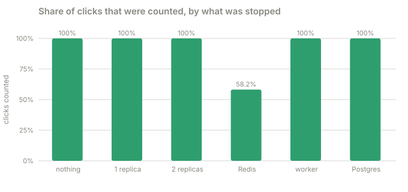
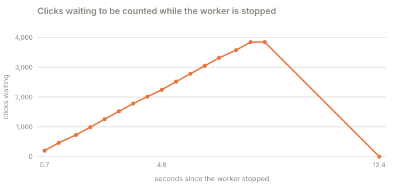

# Part 3 · Break it

**Question:** what do people see when a piece of the system dies?

**Answer:** almost nothing. Across five failures (one API replica, two replicas, Redis, the
worker, Postgres) not one of about 26,000 redirects failed. What changes is what *else* you
lose, and it is different every time: nothing for a replica, speed for the cache, click counts
for Redis, the ability to make new links for the database. Knowing which is which is the whole
point of a design.

## Run it

From the repository folder, with the stack running:

```bash
docker compose -f labs/lab-1-url-shortener/docker-compose.yml up -d --build     # once
uv run labs/lab-1-url-shortener/part-3-break-it/break_it.py            # about three minutes
uv run labs/lab-1-url-shortener/part-3-break-it/break_it.py --quick    # about two minutes
```

It really does run `docker compose stop` on your containers and starts them again, and it
starts them all again at the end even if it fails halfway
([`restore`](break_it.py#L306)). Don't use the page at the same time. It prints its tables
and saves them to [results.md](results.md).

## The idea, from zero

A restaurant has a front desk, three waiters, a pantry of ready-made dishes (the cache), a
notepad where waiters jot down who ordered what (the queue), a bookkeeper who copies the
notepad into the ledger later (the worker), and the ledger itself (the database). What
happens to a diner if each one disappears?

- **A waiter leaves, or two do:** the front desk sends the next order to a waiter who is
  still there. The diner never knows, as long as one is left.
- **The pantry burns:** every dish is cooked from scratch. Slower, but served. The notepad was
  kept in the same pantry, so the orders written down in the meantime are gone.
- **The bookkeeper goes home:** nothing changes for diners. The notepad just fills up, and the
  ledger catches up when the bookkeeper returns.
- **The ledger is locked in the safe:** the diners already known to the pantry are still
  served. Nobody new can be registered.

Each answer follows from where the design puts its state and its slow work. The part checks
that the real system behaves this way, and measures the price.

## What the part does, step by step

| Step | What happens | Code |
|---|---|---|
| 1 | Make 40 links, and one more that is never cached | [`run`](break_it.py#L229) |
| 2 | Keep a steady stream going: 8 workers each pick a random link, ask for it through the gateway and record the status, time and `X-Cache` | [`Traffic`](break_it.py#L50) |
| 3 | Let it run for 2 seconds so the numbers are steady, then break one thing with `docker compose stop` | [`scenario`](break_it.py#L167) |
| 4 | Keep sending for 8 seconds. While the worker is stopped, also read the click backlog twice a second. While Postgres is stopped, also try an uncached link and a new link every half second | [`scenario`](break_it.py#L167), [`database_probe`](break_it.py#L320) |
| 5 | Start it again and poll `/api/health` until it says everything is fine six times in a row | [`seconds_until_healthy`](break_it.py#L119) |
| 6 | Wait for the worker to drain the queue, then add up every link's click count and compare it with the redirects sent | [`drain`](break_it.py#L131), [`total_clicks`](break_it.py#L146) |
| 7 | Do it again for the next thing: one replica, two replicas, Redis, the worker, Postgres | [`run_one`](break_it.py#L252) |

A redirect counts as **failed** if there was no answer or the answer was a 5xx
([`failed`](break_it.py#L106)). A `404` would not count, but none of these links is missing.

## The results

From the last full run on this laptop ([results.md](results.md)):

What the people clicking links saw:

| what broke | redirects sent | failed | served from cache | p50 | p99 |
|---|---|---|---|---|---|
| nothing broken | 4,184 | 0 | 100% | 3.9 ms | 8.7 ms |
| one API replica stopped | 4,344 | 0 | 100% | 3.9 ms | 7.5 ms |
| two API replicas stopped | 4,330 | 0 | 100% | 6.3 ms | 19.6 ms |
| Redis stopped (no cache, no queue) | 3,592 | 0 | 15% | 3.2 ms | 252.7 ms |
| worker stopped (clicks not counted) | 4,288 | 0 | 100% | 2.8 ms | 7.0 ms |
| Postgres stopped (the database) | 5,152 | 0 | 100% | 3.2 ms | 6.2 ms |

What it cost behind the scenes:



| what broke | clicks sent | clicks counted | seconds until all healthy |
|---|---|---|---|
| nothing broken | 6,688 | 6,688 | 1.3 |
| one API replica stopped | 7,499 | 7,499 | 1.3 |
| two API replicas stopped | 8,275 | 8,275 | 1.4 |
| Redis stopped (no cache, no queue) | 7,055 | 4,106 | 2.9 |
| worker stopped (clicks not counted) | 7,377 | 7,377 | 1.3 |
| Postgres stopped (the database) | 9,344 | 9,345 | 3.9 |

The click queue while the worker was stopped for 8 seconds:



While Postgres was stopped, things that *need* the database:

- an uncached link: `503` in about 2.0 s
- making a new link: `503` in about 2.0 s

### Where each number comes from

| Column | In plain words | Measured by | Code |
|---|---|---|---|
| redirects sent, failed | requests during the 8 seconds the thing was stopped, and how many got no answer or a 5xx | the **client** | [`out.failed`](break_it.py#L211) |
| served from cache | share of those answered from Redis (`X-Cache: HIT`). Around 15% with Redis stopped is the cache coming back at the end | the **API**, via a header | [`Traffic`](break_it.py#L50) |
| p50, p99 | typical wait and the 1-in-100 wait during the outage | the client | [`out.p50`](break_it.py#L216) |
| clicks sent | every redirect answered during the scenario, including the seconds before and after | the client | [`out.clicks_sent`](break_it.py#L223) |
| clicks counted | how much the sum of every link's click count in Postgres went up | the **database**, once the queue is empty | [`total_clicks`](break_it.py#L146) |
| seconds until all healthy | from starting the container to six `ok` health checks in a row | the client | [`seconds_until_healthy`](break_it.py#L119) |
| backlog | events waiting in the queue, read from `/api/stats` | the **queue** | [`out.series`](break_it.py#L194) |

## What it means

- **A replica is free to lose, and so are two.** Nothing failed with one gone, and nothing
  failed with two gone and a single replica carrying all the traffic (the typical wait went
  from 3.9 to 6.3 ms). The gateway skips a replica that does not answer its connection within
  a quarter of a second and retries the call on another
  ([nginx.conf](../system/gateway/nginx.conf#L6-L14),
  [proxy_common.conf](../system/gateway/proxy_common.conf#L9-L12)), and replicas hold no
  state, so any of them can answer any request. Healthy again 1.4 seconds after starting them.
- **Redis is optional for correctness and very much not for free.** With it gone, 85% of
  redirects went to Postgres and none failed, because the cache breaker
  ([cache.py](../system/shortener/src/shortener/cache.py#L28)) stops waiting for Redis and
  every call that touches it swallows its errors. The cost shows up in two places. The p99
  is 252.7 ms: every 2 seconds the breaker lets requests try Redis again, and the ones in
  flight at that moment each wait up to 250 ms to find it still down. A breaker that lets
  *one* request test the water, not all of them, would fix that. And only **4,106 of 7,055
  clicks were counted** (58%): click events travel through Redis, so a click that happens
  while Redis is down is gone. That is the price of a best-effort queue. Writing the event to
  disk first, or using SQS, would close the gap (see
  [the AWS option](../README.md#run-it-on-aws-services-locally)).
- **The worker can be down for hours, almost for free.** Redirects did not slow down at all.
  The backlog grew by about 460 clicks a second to 3,865, and 4 seconds after the worker
  came back it was 0 and the counts matched exactly: 7,377 sent, 7,377 counted. This is why
  clicks go through a queue instead of an `UPDATE` inside the redirect.
- **Without the database you can read, but not write.** Every cached link kept redirecting
  (0 failed, 100% from cache), but a link that was not cached, and any attempt to make a new
  one, got a `503` after about 2 seconds, which is the database timeout
  ([store_postgres.py](../system/shortener/src/shortener/store_postgres.py#L15)). When
  Postgres came back, the worker retried the batch it was holding and every click was
  counted.
- **Counted exactly, or counted at least.** Look at the last row: 9,344 clicks sent, 9,345
  counted. That is the *at-least-once* promise showing. The worker was stopped between writing
  a batch and acknowledging it, so the batch came round again and one click was counted
  twice. A counter that is never wrong would need a different design.

### What this part found while it was being built

Part 3 earned its keep. Each of these was a real bug that the earlier parts and the unit
tests did not catch.

1. **1,001 clicks were never counted after Postgres came back.** The worker had given up on
   the batch that failed and moved on to newer events, while the old ones stayed
   unacknowledged in Redis forever. Fix: keep the failed batch and try it again before
   reading anything new ([`ClickCounter`](../system/shortener/src/shortener/worker.py#L27),
   with a test).
2. **A Redis restart would have broken the worker for good.** A restart without saved data
   wipes the consumer group the worker reads through, and the worker would raise `NOGROUP`
   forever. Found by planning the Redis scenario, fixed before it ran: notice the error and
   create the group again ([`consume`](../system/shortener/src/shortener/queue_redis.py#L32),
   with a test).
3. **Two replicas stopped at once made most redirects fail.** In an earlier run 3,159 of
   4,382 redirects got a `502` while the third replica was perfectly healthy. A hand test
   with `curl`, one request at a time, had passed. Two things were wrong. A stopped
   container's address does not refuse connections, it just never answers, so each try cost a
   full second. And nginx looks a name up once, so a replica that came back at a different
   address would never get traffic again. I first tried making nginx look names up again,
   which made things *worse* (`no live upstreams`). What worked: a short connect timeout, and
   fixed addresses for the three replicas in
   [docker-compose.yml](../docker-compose.yml#L124-L131), so a restarted replica is always at
   the address nginx remembers. Now it is a row in the table, so it cannot regress unseen.
4. **The page called a `502` "gateway unreachable".** The health check on the page treated any
   answer that was not JSON as the whole system being down, so one bad moment painted every
   box red. It now tells apart "nothing answered" from "the gateway answered with an error",
   and a request served without the cache says `NO CACHE: Redis is down, so from the database`
   instead of the alarming `BYPASS`.

### Honest limits

- Everything runs on one laptop, so "a replica" is a container, not a machine, and nothing
  here can show what a *network* failure or a slow disk does.
- Each scenario is one 8 second run, and the p99 columns in particular move between runs by
  a few milliseconds. Trust the zeros and the click counts, which do not.
- The database still takes 2 seconds to give up. A second circuit breaker, like the cache's,
  would turn those 2-second waits into instant `503`s. It is the obvious next improvement.
- One Postgres, one Redis, one worker. Part 3 shows each surviving a *restart*. Losing the
  disk, or running more than one of each, is a later lab.

Back to the [lab 1 README](..).
